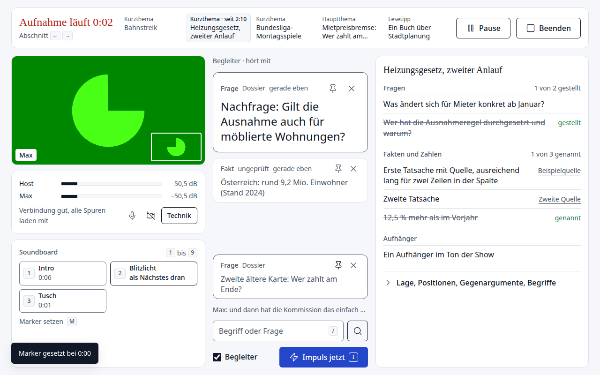
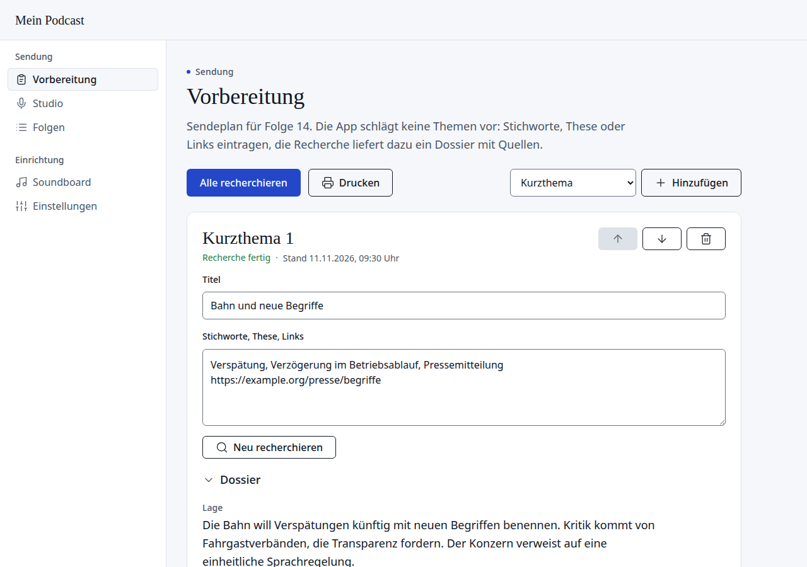

# Regieraum

A self-hosted studio for conversation podcasts with a fixed running order. It covers the whole way from preparation
to the published episode: research dossiers for each segment, a browser studio that records every participant
locally, a live companion that follows the conversation, an audio pipeline on your own server, and your own RSS feed.

The interface is available in German and English. "Regieraum" is the German word for a broadcast control room.



## What it does

- **Preparation.** You plan an episode as a running order of segments (short topics, a main topic, a recommendation,
  free segments; the names are yours). For each segment you enter keywords, a thesis or links, and the app researches
  a dossier with sourced facts, figures, positions, counterarguments, questions and hooks. It never proposes topics
  on its own.
- **Studio.** Host and guests meet in the browser. Every participant is recorded locally and losslessly
  (double-ender) and uploaded in the background; WebRTC is only used for the live conversation. Guests join through a
  link without an account. Video is live only and never recorded. Jingles are audible live and end up sample accurate
  in the mix.
- **Broadcast mode.** While recording, the host sees one screen without scrolling: the running order, the other
  person's video, level meters, the soundboard and the dossier of the current segment. Points that have come up in the
  conversation are struck through automatically.
- **Live companion.** It listens through a live transcript and occasionally shows the host a card: a correction when a
  figure contradicts the dossier, an answer when someone is unsure about a fact, a follow-up question when the
  conversation stalls. It can look things up on the web and shows its source.
- **Audio pipeline.** Aligns the tracks, removes crosstalk, reduces noise (DeepFilterNet), levels and masters to a
  loudness target, mixes in the jingles, writes chapters and a transcript (faster-whisper), and encodes the MP3.
- **Review and edit.** Trim, cut passages on a waveform, rename chapters, edit show notes (with suggestions from the
  transcript), then publish now or at a set time. A recording can be discarded and redone with the same running order.
- **Your own feed.** Episodes and the RSS feed are stored locally or in any S3 compatible storage (tested with
  Cloudflare R2). An importer takes over an existing feed including audio, so a show can move without losing
  subscribers.



## What to know before you start

- Two languages are independent of each other. The **interface** is German or English (Einstellungen → Sprache der
  Oberfläche / Settings → Interface language, or `PS_LANG=en` for a new installation). The **content** the app writes,
  that is dossiers, companion cards, show notes and transcripts, follows the language of the show (`Sprache` /
  `Language` in the show data, for example `de` or `en`). German and English are tested; other show languages
  depend on what the models can do. The prompts themselves are written in German.
- Built for two regular hosts plus occasional guests. Up to four participants talk over a WebRTC mesh.
- One host account. The host signs in with a password; everyone else joins through invitation links.
- The Docker image is x86_64 only (the DeepFilterNet binary).
- The AI features are optional and use your own API keys: Anthropic for dossiers, live hints and show notes, OpenAI
  for the live transcript. Without keys the studio, the audio pipeline and the feed work as usual. As a rough guide
  from real use: a dossier costs about 0.30 to 1 USD per segment, the companion about 1 to 1.30 USD per hour of
  recording, and each automatic web lookup a few cents.
- Processing an hour of recording takes about 12 minutes on a small six-core server, plus the transcript.
- This started as a tool for one show. It has automated tests, but only that one show has used it in production.

## Quick start

You need Docker and, for anything beyond a local test, a domain with HTTPS. Browsers only allow microphone access on
`https://` or `localhost`.

```sh
git clone https://github.com/tobiasredel/regieraum.git
cd regieraum
cp docker-compose.example.yml docker-compose.yml
cp .env.example .env        # set PS_BASE_URL and PS_HOST_PASSWORD (at least 8 characters)
docker compose up -d --build
```

Open `http://localhost:8000`, sign in, and then (page names as in the English interface; set `PS_LANG=en` in `.env`
before the first start, or switch the language under Einstellungen):

1. **Settings**: enter the show data and cover, then under "Show and format" the names of the hosts, the topic and
   tone of the show, the names of your segment types and the running order of a new episode.
2. **Soundboard**: upload jingles and assign keys. A jingle can be tied to a segment type; playing it then advances
   the running order.
3. **Settings → Invitations**: copy the permanent link for your co-host.
4. **Preparation**: fill the running order of the next episode and start the research.
5. **Studio**: record. Afterwards the episode appears under **Episodes** for review and publishing.

### Behind a reverse proxy

- Pass WebSocket connections through (`/ws/p`).
- Do not send a `Permissions-Policy` header that blocks `microphone` or `camera`.
- With `PS_HOST_AUTH=password` the app protects everything itself except the paths guests need. With
  `PS_HOST_AUTH=proxy` the app checks nothing and your proxy has to protect every path except `/join/`, `/api/join`,
  `/api/p/`, `/ws/p`, `/static/`, `/public/` and `/healthz`.

### Connections from mobile networks

Participants behind strict firewalls or on mobile networks may need a TURN relay. Set `PS_TURN_MODE` to `static`
(your own TURN server) or `cloudflare` (Cloudflare Realtime TURN key). The relay is only used when a direct connection
fails, and only for the live conversation; recordings are always uploaded directly.

### Moving an existing show

Under **Settings → Import** enter the address of your current feed. The importer copies show data, cover and all
episodes with unchanged GUIDs. Check the new feed, then set the redirect at your old host.

## Configuration

All settings are environment variables; `.env.example` lists the common ones and `docs/SPEC.md` (German, section 2)
all of them. The data directory (`PS_DATA`, `/data` in the container) holds the SQLite database, raw tracks, episodes
and models. Back up that directory.

The look comes from a theme in `app/static/design/`. A neutral default theme is included; `docs/THEME.md` describes
how to mount your own.

## Development

No Python on the host is needed, everything runs in a container:

```sh
./dev.sh build                  # dev image, once and after changes to requirements
./dev.sh test                   # pytest
./dev.sh serve 8197             # app with reload on http://127.0.0.1:8197, no login
```

Browser tests live in `tests/e2e/` (studio) and `tests/e2e-manage/` (management pages) and use Playwright with
Chromium's fake camera and microphone. `docs/SPEC.md` is the specification the code follows: data model, protocol,
audio pipeline and prompts.

The code has four parts that only talk through narrow interfaces: `app/` (server and web interface), `pipeline/`
(audio processing, run as subprocesses), `publish/` (storage, feed, import, show notes) and `assist/` (dossiers and
live companion).

## Credits

- Noise reduction by [DeepFilterNet](https://github.com/Rikorose/DeepFilterNet), transcripts by
  [faster-whisper](https://github.com/SYSTRAN/faster-whisper).
- Icons from [Lucide](https://lucide.dev) (ISC license).
- The interface was reviewed with [unslop](https://github.com/heydamir/unslop) by Damir Sokolovsky (CC BY 4.0).

## License

MIT, see [LICENSE](LICENSE).
